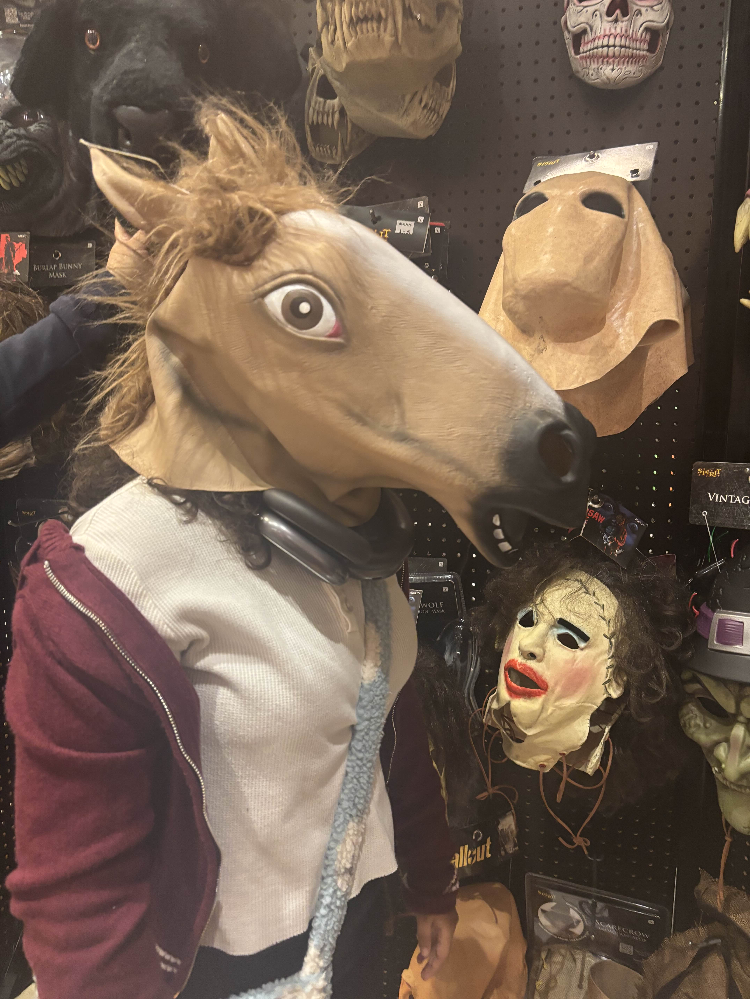
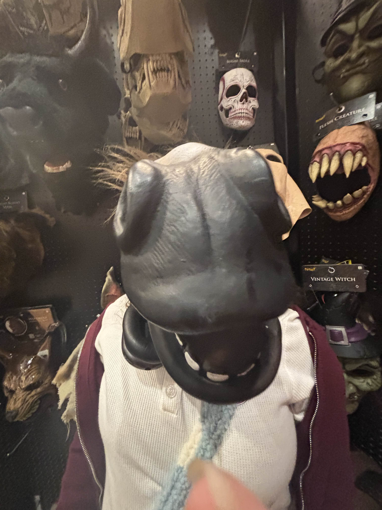
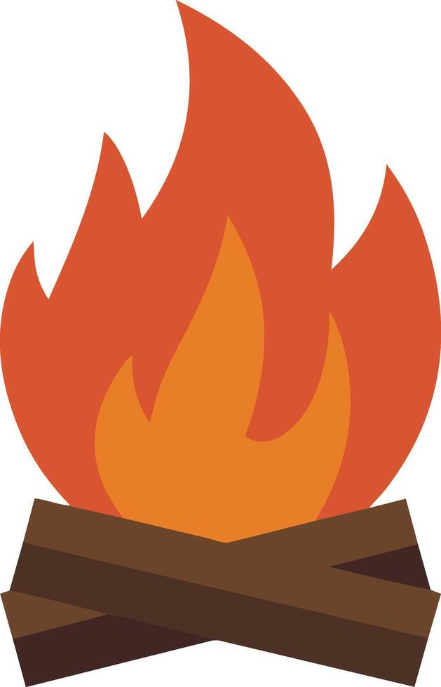

# ***Alyssa's Markdown!!***

## Introduction


Hello im Alyssa and this is my markdown

## Technical background

I don't have much of an technical background besides messing around in inspect so all of this is new to me

## Lists

### Tasks
- [x] Finish Markdown
- [ ] Build a Site, Then Restructure it by Hand midterm
- [ ] Dont use Ai unless its required to be used
- [ ] Code checkpoints
- [ ] Project brief

---

### Favorite web design tools and code 
* Visual Studio Code
* Github
* Carrd.com
* `Html`
* `Markdown`
##### ~~The only ones I used except carrd~~
---
### Personal goals (Ordered list)
1. Learn html
2. Learn css
3. Learn json
4. Learn markdown
 ##### When I say learn I mean enough to remember when this course is over

## External links

[Link to the Newpaltz website assignment](https://web-design-fall-2026-suny-website.vercel.app)

[Link to my repo](https://github.com/ACode1105/web-design-fall-2026)

## Block quote

A learning quote from one of my dear parents
> "Were not poor, were broke."
## Code block
#### The code that represents me the most is a simple **html** code for clicking a button
```html
 <button>click</button>
```

**EXAMPLE!**->
<button>COOLBUTTON</button>

## Profile Picture 

I dont know if this counts as a profile picture but heres two of me as horse #bojacklyssa

 

---

You made it to the end! Have a seat!


*crackle noises* *crackle noises* 

~~Pretend you hear the fire crackling for effect~~